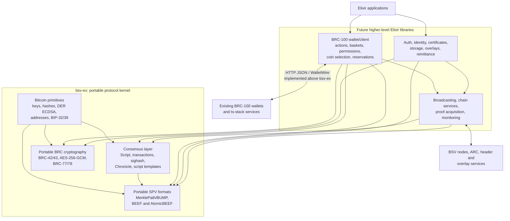

# `bsv-ex` as a foundation for an Elixir BSV stack

## Purpose and scope

This document assesses whether `bsv-ex` provides the low-level building blocks
needed by future Elixir libraries implementing a BRC-100 wallet, wallet
services, or a broader equivalent of the TypeScript `ts-stack`.

The target is deliberately **not** API parity with `@bsv/sdk` and is **not** a
wallet implementation inside `bsv-ex`. The target is a portable protocol kernel
with deterministic cryptography, canonical binary formats, consensus-correct
transactions and scripts, and pure SPV verification. Higher-level libraries
should be able to depend on that kernel without reimplementing Bitcoin or BRC
wire primitives.

The TypeScript reference used for this assessment is `ts-stack` commit
[`84f09b0`](https://github.com/bsv-blockchain/ts-stack/tree/84f09b07a93aa7a36d4f72b739b4b65a512ca1f8),
containing `@bsv/sdk` 2.1.8 and `@bsv/wallet-toolbox` 2.4.2.

## Conclusion

`bsv-ex` is a sound starting point for this narrower role. It already owns the
right base abstractions: keys, hashes, signatures, scripts, transactions,
blocks, headers, and a contract-oriented script builder. Its principal gaps are
not wallet state or network integration; they are modern portable formats and
cryptographic standards that a wallet library would otherwise have to
duplicate.

The most important additions are:

1. Consensus-complete transaction signing and Script behavior, including
   Chronicle.
2. BUMP/MerklePath and BEEF/AtomicBEEF serialization and verification.
3. BRC-42/43 counterparty key derivation.
4. The exact AES-256-GCM, BRC-77, and BRC-78 byte formats.
5. Common script templates such as PushDrop.

With those pieces, a separate Elixir wallet project could implement BRC-100
actions, persistence, permissions, transports, and monitoring without importing
another Bitcoin implementation.

## Component boundary



The boundary is based on determinism and ownership:

- If a function can be evaluated from explicit byte/string/value inputs without
  storage, user interaction, or network access, it is a candidate for `bsv-ex`.
- If it manages identities, permissions, mutable UTXO state, retries, remote
  calls, or an action lifecycle, it belongs in a higher-level library.

## Low-level capability matrix

| Capability | Current `bsv-ex` approach | Foundational assessment | Recommended ownership |
|---|---|---|---|
| Hashes, HMAC, Base58Check | Implemented | Strong. Add cross-language vectors and make argument ordering explicit. | `bsv-ex` |
| Private/public keys, WIF, P2PKH addresses | Implemented | Strong common wire compatibility. | `bsv-ex` |
| BIP-39 and BIP-32 | Implemented | Useful, but independent of BRC-42; retain both. | `bsv-ex` |
| ECDSA and DER signatures | Implemented through Curvy | Suitable base. Expand validation, low-S/high-S, malformed DER, and Chronicle-era tests. | `bsv-ex` |
| BRC-42/43 derivation and key linkage | Missing | Critical gap. BIP-32 cannot substitute for counterparty/invoice derivation. | `bsv-ex` |
| AES-256-GCM symmetric messages | Missing | Critical wallet-crypto primitive. Match the SDK framing exactly. | `bsv-ex` |
| Legacy BIE1 and Bitcoin Signed Message | Implemented | Keep for compatibility, but do not present as BRC-77/78 equivalents. | `bsv-ex` |
| BRC-77 signed messages | Missing | Important portable message format. | `bsv-ex` |
| BRC-78 encrypted messages | Missing | Important portable message format built on BRC-42 and AES-GCM. | `bsv-ex` |
| Raw transaction codec and TXID | Implemented | Strong foundation. Tighten strict parsing and edge-case validation. | `bsv-ex` |
| Transaction construction and basic fees | Implemented | Appropriate as a low-level builder; wallet funding and coin selection remain out of scope. | Split: builder in `bsv-ex`, funding above it |
| FORKID/BIP143 signing | Implemented | Good existing subset; the ABC vector corpus passes. | `bsv-ex` |
| Legacy OTDA signing | Partially implemented | Needs complete edge-case coverage, including the historical `SIGHASH_SINGLE` result. | `bsv-ex` |
| Chronicle sighash and transaction semantics | Partial on `chronicle-opcodes` | Restored opcodes and canonical names are present; Chronicle sighash dispatch and transaction-version-dependent malleability rules remain critical gaps. | `bsv-ex` |
| Script parser, serializer, and VM | Implemented broadly | Valuable base, including the restored Chronicle opcodes on `chronicle-opcodes`; policy/consensus flags and version-dependent behavior still need explicit modeling. | `bsv-ex` |
| P2PKH, P2PK, multisig, R-puzzle, OP_RETURN | Implemented | Useful templates; retain Elixir-native contract ergonomics. | `bsv-ex` |
| PushDrop | Missing | Important for overlays and token protocols; add as a pure script template. | `bsv-ex` |
| TSC Merkle proof | Implemented | Preserve as a legacy format and optionally provide conversion. | `bsv-ex` |
| BUMP/MerklePath | Missing | Critical modern SPV primitive. It is not the same serialization as the current TSC proof. | `bsv-ex` |
| BEEF v1/v2 | Missing | Critical transaction-graph and proof envelope. | `bsv-ex` |
| AtomicBEEF/BRC-95 | Missing | Critical for exchanging BRC-100 action results. | `bsv-ex` |
| Extended transaction format (EF) | Missing | Useful bridge format; implement alongside BEEF if required by consumers. | `bsv-ex` |
| Pure SPV verification | Partial | Provide verification from explicit transaction, proof, and header inputs. Do not fetch headers here. | `bsv-ex` |
| Chain tracker and broadcaster | Missing | Correctly absent from the portable kernel. Define these in a network/services package. | Higher-level library |
| BRC-100's 28 wallet methods | Missing | Correctly out of scope. They should consume `bsv-ex` types and encodings. | Wallet library |
| Actions, baskets, labels, UTXO reservations | Missing | Correctly out of scope; these are durable wallet state and concurrency concerns. | Wallet library |
| Certificates, permissions, originators, UI approval | Missing | The cryptographic encodings may later be factored down, but lifecycle and policy stay above the kernel. | Auth/wallet library |
| Wallet substrates and HTTP/Wire RPC | Missing | Correctly out of scope. A BRC-100 client library should own transport and error mapping. | Wallet client library |
| Monitor, retries, proof acquisition, reorg handling | Missing | Correctly out of scope. | Network/wallet services |

## Recommended module shape

The existing public modules should remain stable where possible. Modern
standards can be added without making the core transaction struct behave like a
stateful SDK object.

```text
BSV.Hash                         existing primitives
BSV.PrivKey / BSV.PubKey        existing key types
BSV.Tx / BSV.TxIn / BSV.TxOut   canonical raw transaction only
BSV.Sig                         consensus sighash and transaction signatures
BSV.Script / BSV.VM             parsing and pure evaluation

BSV.KeyDerivation.BRC42         counterparty/invoice child derivation
BSV.KeyDerivation.BRC43         protocol/key-ID normalization and validation
BSV.SymmetricKey                exact AES-256-GCM framing
BSV.Message.BRC77               modern signed message envelope
BSV.Message.BRC78               modern encrypted message envelope

BSV.MerklePath                  BUMP/MerklePath codec and pure verification
BSV.Beef                        BEEF graph, codec, validation, and merging
BSV.Beef.Tx                     raw transaction / txid-only / proof association
BSV.AtomicBeef                  BRC-95 subject transaction envelope

BSV.Contract.PushDrop           pure locking/unlocking script template
```

The existing [`BSV.MerkleProof`](../lib/bsv/merkle_proof.ex) should not be
silently changed to mean BUMP. A distinct `BSV.MerklePath` type makes format
selection explicit and permits a tested TSC-to-BUMP converter.

Likewise, BEEF source graphs should not be stored inside [`BSV.Tx`](../lib/bsv/tx.ex).
A raw transaction has a canonical Bitcoin serialization; BEEF is a separate
envelope that owns parent relationships and proofs.

## Compatibility means bytes, not matching TypeScript classes

Elixir does not need to imitate mutable TypeScript classes or Promise-based
methods. It needs to produce and accept the same externally specified bytes.

Recommended API conventions are:

- Use binaries internally rather than emulating `number[]` or `Uint8Array`.
- Offer `from_binary/1`, `to_binary/1`, `from_hex/1`, and `to_hex/1` at format
  boundaries.
- Use tagged return values plus explicit bang variants where appropriate.
- Let lower-level parsers return unconsumed input; let public decoders reject
  trailing bytes by default.
- Pass network and verification context explicitly instead of relying on global
  configuration for consensus-sensitive operations.
- Keep consensus behavior separate from configurable policy checks.
- Preserve unknown metadata only where its standard requires round-trip
  preservation.

Class and field names may be idiomatic Elixir. Compatibility should be judged
by golden vectors for serialization, hashes, signatures, key derivation, and
validation outcomes.

## Conformance strategy

Every new portable standard should ship with vectors exercised in both
implementations. At minimum, the corpus should cover:

1. WIF, public key, address, hash, HMAC, and DER encodings.
2. Raw transaction parsing, reserialization, TXIDs, all sighash modes, and
   Chronicle OTDA dispatch.
3. Script evaluation against the same valid/invalid and Chronicle vector sets.
4. BRC-42 public/private derivation from both parties, including `self` and
   `anyone` behavior.
5. AES-GCM ciphertext layout and tamper rejection.
6. BRC-77 and BRC-78 messages in both Elixir-to-TypeScript and
   TypeScript-to-Elixir directions.
7. BUMP/MerklePath parsing, root computation, merging, trimming, and extraction.
8. BEEF v1/v2 and AtomicBEEF parsing, deterministic serialization, parent graph
   resolution, proof association, and invalid graph rejection.

Vectors should be checked into this repository rather than generated during a
test run. Generation scripts should record the exact upstream `ts-stack` commit
used.

## Implementation order

### Phase 0: restore a trustworthy baseline

- Keep tests that mutate application-wide network configuration synchronous.
- Make dependency resolution reproducible on supported Elixir versions.
- Remove or resolve the excluded legacy sighash test.
- State supported Elixir/OTP versions and run them in CI.

### Phase 1: consensus correctness

- Complete legacy OTDA edge cases.
- Complete the restored-opcode work already present on `chronicle-opcodes` with
  Chronicle sighash dispatch.
- Model transaction-version-dependent malleability behavior.
- Import the matching node and SDK Script/sighash vectors.

### Phase 2: modern SPV interchange

- Add `BSV.MerklePath`/BUMP.
- Add BEEF v1/v2 and AtomicBEEF.
- Add pure graph and proof validation.
- Add TSC-proof conversion without changing the legacy type.

### Phase 3: wallet-grade cryptographic primitives

- Add BRC-42/43 derivation.
- Add AES-256-GCM with the SDK's exact IV/ciphertext/tag layout.
- Add BRC-77 and BRC-78 message envelopes.
- Add constant-time verification where secret material is compared.

### Phase 4: reusable script templates and ergonomics

- Add PushDrop and any other templates required by overlay protocols.
- Add an optional pure fee-model behavior, without broadcasting or live policy
  retrieval.
- Publish examples showing how a future wallet library consumes BEEF,
  MerklePath, BRC-42, and transaction-signing primitives.

## Explicit non-goals

The following should not be required before treating `bsv-ex` as a successful
foundation:

- Implementing `WalletInterface` or matching all `@bsv/sdk` exports.
- Coin selection, change management policy, action references, or output
  reservations.
- SQL schemas, migrations, synchronization, or a wallet monitor.
- ARC, WhatsOnChain, or Teranode clients.
- Browser, React Native, XDM, HTTP, or WalletWire transports.
- Permission prompts, application-origin policy, or certificate lifecycle.
- Overlay discovery, registries, storage services, or remittance workflows.

Those are valid future Elixir projects. Their shared cryptographic and binary
dependencies are the appropriate scope of `bsv-ex`.

## Current repository health note

On `chronicle-opcodes`, two randomized full-suite runs each execute 88 doctests
and 377 tests with no failures and one excluded test. An async test that changed
the application-wide BSV network was made synchronous to remove a cross-test
race. The remaining exclusion is the legacy Bitcoin Core sighash vector suite;
resolving it is still required before treating transaction signing as a complete
compatibility baseline.

Finally, this repository is Apache-2.0 while `ts-stack` uses Open BSV License
version 4. New implementations should be based on published standards and
recorded interoperability vectors, with the licensing implications reviewed
before translating upstream implementation code directly.
